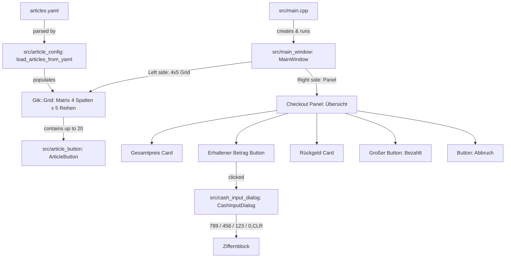

# Project Context & AI Agent Guide: Caisse (POS System)

This document provides complete architectural context, design decisions, implementation details, and extension guidelines for AI agents and developers working on this codebase.

---

## 1. Project Overview

- **Name:** Caisse (French for "Cash Register" / "Checkout")
- **Application ID:** `de.pos.caisse`
- **Domain:** Touchscreen-friendly Point-of-Sale (POS) cash register interface.
- **Language & Standard:** C++20 (`-std=c++20`, `-Os -flto -Wall -Wextra`)
- **UI Toolkit:** `gtkmm-4.0` (C++ bindings for GTK 4)
- **Target Platform:** Linux (Debian / Ubuntu)
- **Binary Size:** Highly optimized (~136 KB stripped)

---

## 2. Directory Structure

```text
caisse/
├── Makefile                # Build configuration (out-of-source builds to build/)
├── articles.yaml           # YAML configuration for the 4x5 article matrix
├── README.md               # User-facing summary & quickstart instructions
├── INFO.md                 # This document (AI Agent and architectural context)
├── .gitignore              # Ignores build/, caisse, *.o, *.d
└── src/
    ├── main.cpp            # Application entry point (Gtk::Application)
    ├── main_window.hpp     # Main window header (split: 4x5 matrix & checkout panel)
    ├── main_window.cpp     # Main window implementation & event wiring
    ├── article_button.hpp  # ArticleButton header (derived from Gtk::Button)
    ├── article_button.cpp  # ArticleButton implementation, styling & gesture logic
    ├── article_config.hpp  # Article configuration struct & YAML loader header
    ├── article_config.cpp  # Pure C++ YAML parser (no external library dependencies)
    ├── cash_input_dialog.hpp # Keypad modal dialog (789/456/123/0,CLR) header
    └── cash_input_dialog.cpp # Keypad modal dialog implementation & shortcuts
```

> **Note on Build Artifacts:**  
> All intermediate files (`.o`, `.d`) are placed in the `build/` directory. The `src/` directory contains strictly source code files (`.hpp`, `.cpp`).

---

## 3. Architecture & Key Components



### 3.1 `src/main.cpp`
- Initializes `Gtk::Application::create("de.pos.caisse")`.
- Launches `MainWindow` via `app->make_window_and_run<MainWindow>(argc, argv)`.

### 3.2 `src/main_window.hpp` / `src/main_window.cpp`
- Inherits from `Gtk::Window`.
- Runs automatically in fullscreen mode (`fullscreen()`).
- Pressing `Escape` closes the application; `F11` toggles fullscreen.
- **Left Side (3/4 of width):** 4 columns × 5 rows homogeneous grid populated dynamically from `articles.yaml`.
- **Right Side (1/4 of width):** Checkout panel with enlarged typography:
  - **Gesamtpreis:** Automatically sums `amount * price` of all selected items in 32pt bold.
  - **Erhaltener Betrag:** Clickable card opening `CashInputDialog`.
  - **Rückgeld:** Dynamically calculated (`received - total`). Displays positive change in green or remaining balance in red in 32pt/26pt bold.
  - **Bezahlt:** Prominent large button (80px height). Dynamically turns green (`#16a34a`) once the received amount is sufficient; otherwise neutral dark slate (`#334155`).
  - **Abbruch:** Always red button (`#dc2626`). Cancels transaction and resets counts.

### 3.3 `src/article_config.hpp` / `src/article_config.cpp`
- Self-contained pure C++ parser (no `libyaml-cpp` or external library required).
- Supports German and English field names:
  - `artikelname` / `name`
  - `artikelpreis` / `preis` / `price` (supports dot `.` or comma `,`)
  - `farbe` / `color` (preserves unquoted hex color codes e.g. `#8B5A2B`)
  - `sichtbarkeit` / `visible` (`true`, `false`, `ja`, `nein`, `1`, `0`)
  - `position`: `[x, y]`, `{x: 0, y: 1}`, or separate `x:`, `y:` lines.
- Auto-generates a full 20-item `articles.yaml` file if none exists.

### 3.4 `src/cash_input_dialog.hpp` / `src/cash_input_dialog.cpp`
- GTK 4 modal dialog (`set_modal(true)`, `set_transient_for(parent)`).
- Clean, uncluttered layout with large touch-friendly buttons (26pt bold).
- Keypad layout:
  ```text
  7  8  9
  4  5  6
  1  2  3
  0  ,  CLR
  ```
- Action buttons: `Abbrechen` (red) and `Übernehmen` (green).
- Keyboard navigation: Digits, comma/dot, Backspace, Delete, Enter, Escape.

### 3.5 `src/article_button.hpp` / `src/article_button.cpp`
Custom tile component widget inheriting from `Gtk::Box`:
- **Top / Header (`m_header_box`):** 
  - Central article title label with word wrap and Pango markup, standing prominently on its own.
- **Center / Action Buttons (`m_button_box`):**
  - **Increment Button ("+"):** Touch-optimized main button in configured article color.
  - **Decrement Button ("-"):** Touch-optimized button in subtly lightened variant of article color.
  - Generous spacing between both buttons for optimal touch ergonomics.
- **Bottom / Footer (`m_footer_box`):**
  - **Counter Badge (`m_amount_label`):** Permanent amount badge situated at the bottom-left.
  - **Unit Price (`m_price_label`):** Formatted unit price situated at the bottom-right.
- **Whole Tile Styling:**
  - The configured article color (`color_plus`) extends seamlessly across the entire tile background up to the outer border.
  - Automatic contrast adjustment for typography and badges (white text on dark colors, dark text on bright colors).
  - 3D tactile elevation with hover effects and active click depression.

---

## 4. Critical Technical Details & GTK 4 Pitfalls

### 4.1 GTK 4 Dialogs Are Asynchronous / Window-Based
- `gtk_dialog_run()` has been removed in GTK 4.
- Modal dialogs must derive from `Gtk::Window`, configure `set_modal(true)` and `set_transient_for(parent)`, and be shown using `present()`.
- Data communication uses signals (`sigc::signal<void(double)>`).

### 4.2 Typography: Pango Markup Over CSS
- GTK CSS does not support `rem` units; declarations are silently ignored.
- Use Pango Markup (`set_markup("<span size='16pt' weight='bold' ...>")`) for consistent, reliable font sizing.

### 4.3 Long-Press Gesture Handling
- Built-in `GestureLongPress` is limited to ~1.0s.
- Custom implementation uses `GestureClick` in `PropagationPhase::CAPTURE` paired with `Glib::signal_timeout`.
- **Do not cancel long press on `GestureClick::signal_stopped()`**; GTK fires this after 250–400ms for double-click detection.

---

## 5. Build System & Tooling

The [`Makefile`](file:///home/oliver/Development/c++/gtk/caisse/Makefile) uses standard GNU Make with aggressive size optimizations:
- `-Os -flto=auto -ffunction-sections -fdata-sections -Wl,--gc-sections -Wl,--as-needed -Wl,-s`
- Generates a standalone, fully-featured binary of ~156 KB.

Commands:
```bash
make        # Compile and link
make run    # Run application
make clean  # Clean build artifacts
```
