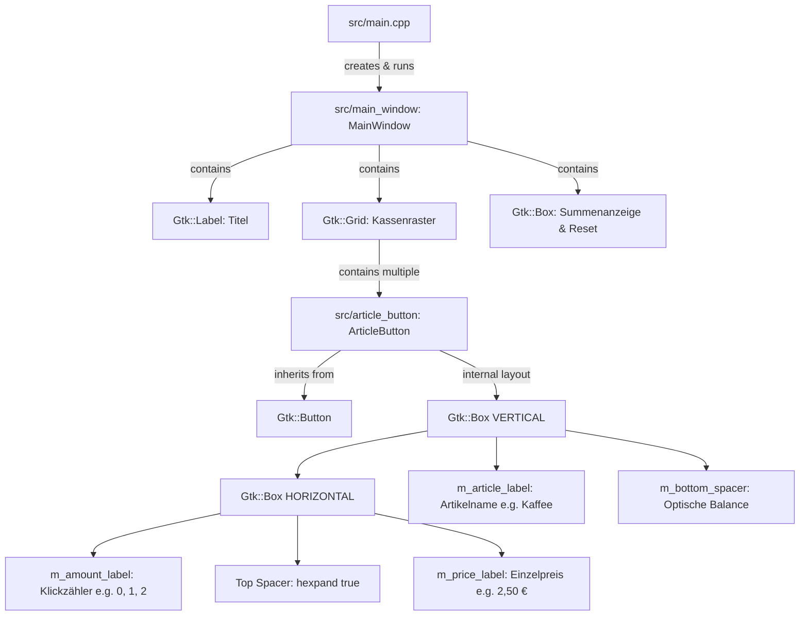

# Project Context & AI Agent Guide: Caisse (POS System)

This document provides complete architectural context, design decisions, implementation details, and extension guidelines for AI agents and developers working on this codebase.

---

## 1. Project Overview

- **Name:** Caisse (French for "Cash Register" / "Checkout")
- **Application ID:** `de.pos.caisse`
- **Domain:** Touchscreen-friendly Point-of-Sale (POS) cash register interface.
- **Language & Standard:** C++20 (`-std=c++20`, `-O2 -Wall -Wextra`)
- **UI Toolkit:** `gtkmm-4.0` (C++ bindings for GTK 4)
- **Target Platform:** Linux (Debian / Ubuntu)

---

## 2. Directory Structure

```text
caisse/
├── Makefile            # Build configuration (out-of-source builds to build/)
├── README.md           # User-facing summary & quickstart instructions
├── INFO.md             # This document (AI Agent and architectural context)
├── .gitignore          # Ignores build/, caisse, *.o, *.d
└── src/
    ├── main.cpp        # Application entry point (Gtk::Application)
    ├── main_window.hpp # Fullscreen window header
    ├── main_window.cpp # Fullscreen window layout, grid & event wiring
    ├── article_button.hpp # ArticleButton class header (derived from Gtk::Button)
    └── article_button.cpp # ArticleButton implementation, styling & gesture logic
```

> **Note on Build Artifacts:**  
> All intermediate files (`.o`, `.d`) are placed in the `build/` directory. The `src/` directory contains strictly source code files (`.hpp`, `.cpp`).

---

## 3. Architecture & Key Components



### 3.1 `src/main.cpp`
- Initializes `Gtk::Application::create("de.pos.caisse")`.
- Launches `MainWindow` via `app->make_window_and_run<MainWindow>(argc, argv)`.

### 3.2 `src/main_window.hpp` / `src/main_window.cpp`
- Inherits from `Gtk::Window`.
- Runs automatically in fullscreen mode (`fullscreen()`).
- Pressing `Escape` closes the application (via `Gtk::EventControllerKey`).
- Manages an array of `ArticleButton` pointers in a 3-column `Gtk::Grid`.
- Wires both `signal_clicked()` and `signal_long_pressed()` of each button to `update_total_display()`.
- Calculates total sales sum using `ArticleButton::format_currency(total)` and displays total item count.
- Provides a global "Alles zurücksetzen" button (`reset_all()`).

### 3.3 `src/article_button.hpp` / `src/article_button.cpp`
The core reusable component. Inherits from `Gtk::Button`.

#### Visual Layout:
```text
+-------------------------------------------------------------+
|  0  (m_amount_label)                 2,50 € (m_price_label) |
|                                                             |
|                      Kaffee (m_article_label)               |
|                                                             |
+-------------------------------------------------------------+
```

#### Core Properties & Methods:
| Property | Type | Methods | Description |
| :--- | :--- | :--- | :--- |
| `article` | `Glib::ustring` | `get_article()`, `set_article()` | Product name in the center |
| `color` | `Glib::ustring` | `get_color()`, `set_color()` | Background color (hex or CSS name) |
| `price` | `double` | `get_price()`, `set_price()` | Unit price (formatted top-right) |
| `amount` | `int` | `get_amount()`, `set_amount()`, `reset_amount()`, `reset()` | Click counter (top-left badge) |
| `totalprice` | `double` | `get_totalprice()`, `get_total_price()` | Computed as `amount * price` |
| `font_size` | `Glib::ustring` | `get/set_article_font_size`, `get/set_price_font_size`, `get/set_amount_font_size` | Font sizes for all 3 labels |
| `long_press` | `unsigned int` | `get/set_long_press_duration_ms`, `signal_long_pressed()` | Long-press (>3s) threshold and event signal |

---

## 4. Critical Technical Details & GTK 4 Pitfalls

When modifying or extending this project, keep these GTK 4-specific rules in mind:

### 4.1 Typography: Use Pango Markup, NOT CSS for Label Sizes
- **GTK CSS does NOT support web units like `rem`!** Any declaration using `rem` is silently ignored by GTK 4.
- In GTK 4, container widget `StyleContext`s **do not propagate CSS down to child labels**.
- **Solution used:** Label typography is rendered directly via Pango Markup using `label.set_markup("<span size='24pt' weight='bold' ...>...</span>")`.
- Valid Pango size values: Points (`"24pt"`, `"12pt"`), percentages (`"200%"`), or keywords (`"xx-large"`).

### 4.2 Dynamic Color & Contrast
- `ArticleButton::is_light_background()` parses `m_color` via `Gdk::RGBA` and calculates luminance:
  $$\text{Luminance} = 0.299 \cdot R + 0.587 \cdot G + 0.114 \cdot B$$
- If luminance $> 0.55$, text is rendered dark (`#1c1c1e`); otherwise, text is rendered white (`#ffffff`).
- The amount badge background switches dynamically between `rgba(0,0,0,0.16)` and `rgba(255,255,255,0.28)`.

### 4.3 3D Tactile Elevation & Press-Down
- Implemented in `ArticleButton::update_style()` using GTK 4 CSS:
  - **Resting state:** `box-shadow: 0 4px 6px rgba(0,0,0,0.35), 0 1px 3px rgba(0,0,0,0.2);`
  - **Hover state (`:hover`):** `box-shadow: 0 6px 12px rgba(0,0,0,0.42); filter: brightness(1.08);`
  - **Active state (`:active`):** `box-shadow: 0 1px 2px rgba(0,0,0,0.25); transform: translateY(3px); filter: brightness(0.93);`
  - **Transition:** `transition: all 120ms ease;`

### 4.4 Long-Press (>3s) Reset Implementation
- GTK's built-in `Gtk::GestureLongPress` has a hard-coded maximum duration of ~1.0s (`delay_factor <= 2.0`).
- **Solution implemented:**
  1. A `Gtk::GestureClick` in `PropagationPhase::CAPTURE` starts a `Glib::signal_timeout` for `m_long_press_duration_ms` (default: 3000 ms).
  2. If the user releases before 3s or moves the cursor out (`EventControllerMotion::signal_leave`), the timer is disconnected.
  3. **DO NOT connect timer cancellation to `GestureClick::signal_stopped()`!** GTK emits `signal_stopped()` automatically after ~250–400ms (the double-click threshold), which would prematurely cancel long-press timers.
  4. When the 3s timeout fires, `m_long_press_triggered = true`, `reset_amount()` is called, and `signal_long_pressed()` is emitted.
  5. When the user releases the button, `ArticleButton::on_clicked()` checks `m_long_press_triggered`, suppresses the normal click event, and resets the flag.

---

## 5. Build System & Tooling

The [`Makefile`](file:///home/oliver/Development/c++/gtk/caisse/Makefile) uses standard GNU Make conventions and size-optimized production flags:

- **Build output:** Intermediate files go into `build/`, executable `caisse` is placed in project root.
- **Header dependency tracking:** `-MMD -MP` flags generate `.d` dependency files in `build/`, included via `-include $(DEPS)`. Editing any `.hpp` file triggers recompilation of only the affected translation units.
- **Binary Size Optimizations:**
  - `-Os`: Code size optimization.
  - `-flto`: Link-time whole-program optimization.
  - `-ffunction-sections -fdata-sections` & `-Wl,--gc-sections`: Unused code/data elimination.
  - `-Wl,--as-needed`: Omits unused shared library dependencies.
  - `-Wl,-s`: Strips symbol tables, reducing binary size from 148 KB to ~79 KB.
- **Commands:**
  ```bash
  make        # Compile and link the application
  make run    # Compile (if needed) and run ./caisse
  make clean  # Remove build/ directory and caisse executable
  ```

---

## 6. How to Extend the Project

### Adding New Articles
In [`src/main_window.hpp`](file:///home/oliver/Development/c++/gtk/caisse/src/main_window.hpp):
1. Declare new `ArticleButton` members:
   ```cpp
   ArticleButton m_btn_espresso{"Espresso", 1.90, "#5A3825"};
   ```
2. Add the pointer to `m_articles`:
   ```cpp
   std::vector<ArticleButton*> m_articles{ ..., &m_btn_espresso };
   ```
3. Adjust the grid layout columns/rows in [`src/main_window.cpp`](file:///home/oliver/Development/c++/gtk/caisse/src/main_window.cpp#L29) if needed (currently auto-wraps after 3 columns).

### Ideas for Future Features
- **Cart / Receipt View:** A side panel (`Gtk::ListView` or `Gtk::ColumnView`) displaying an itemized list of all articles where `amount > 0`.
- **Payment / Checkout Dialog:** A modal dialog showing total sum, cash given, and change calculated.
- **Category Tabs:** A `Gtk::Notebook` or `Gtk::Stack` with switcher for categories (e.g. "Heißgetränke", "Kaltgetränke", "Speisen").
- **Persistence / Configuration:** Loading articles, prices, and colors from a JSON/YAML file instead of hardcoded instances.
- **Audio / Haptic Feedback:** Playing a short click or beep sound on press / long-press reset.

